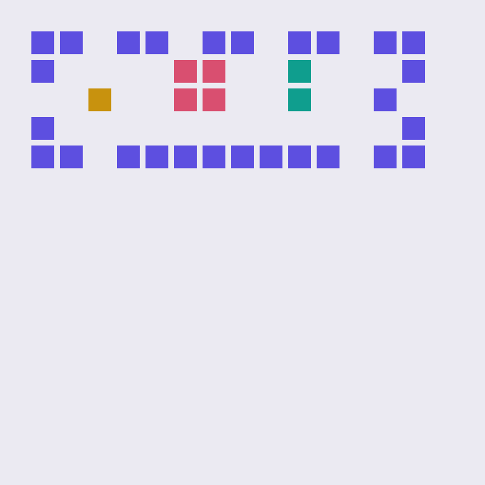

# ULTRON Lab

**Learn data structures and algorithms by playing them, building them, and being quizzed on them.** The full curriculum of Pat Morin's *[Open Data Structures](http://opendatastructures.org)* (CC BY), rebuilt as 12 interactive 3D worlds — plus a **build-your-own-everything** track (git, vim, a database, a ray tracer, a neural net…), a **probability & statistics** wing, and an **interview arena** wired to the classic questions.

**Live:** https://srivtx.github.io/prj-117-108-116-114-111-110/ · **Verified:** `node tools/verify.mjs` → 78 checks, 0 failures, run on every push.

*(The repo name decodes itself: 117·108·116·114·111·110 are the ASCII codes of U-L-T-R-O-N.)*



---

## Why this exists

Most explanations of a data structure show you a static diagram and ask you to trust a conclusion you never checked. This lab is built around a different loop, for people whose brains refuse to accept "it just works":

1. **Play it by hand.** Before any algorithm runs, you do its job yourself: shift the array blocks right-to-left, splice the list by tapping the two pointers, walk the trie bit by bit, triage the ER patients.
2. **Predict, then watch.** Stories lock in a guess first ("how deep is a treap after 15 sorted inserts?") and grade you against *your own run* — never a canned answer.
3. **Name it last.** Words like *amortized*, *load factor* or *rotation* appear only after you've felt the phenomenon they name.
4. **Why this design?** Every world ends with the trade-offs: what this structure buys, what it pays, and which real system chose it.

No shortcuts: the structures on screen are the real implementations, running live in `learn/ds.js` — and the same file is unit-tested in node by the verify script.

---

## The 12 worlds

| # | World | ODS | What you do |
|---|-------|-----|-------------|
| 1 | **Growth** | §1 | Scale six growth-class towers yourself; walk the binary-search staircase; feel why 10⁶×10⁶ = 16 minutes |
| 2 | **Arrays** | §2 | Shift blocks by hand for a front insert, watch doubling pre-pay itself (amortization), ride the circular queue, meet the triangle trick |
| 3 | **Chains** | §3 | Splice a linked list with two taps, then feel random access die on the get(i) walk; meet the cache bill |
| 4 | **Skiplists** | §4 | Flip coins for tower heights, ride express lanes down to a key, prove the ⅛ height-4 chance |
| 5 | **Hashing** | §5 | Execute the multiply-and-shift hash pipeline by hand, collide with the birthday paradox, probe linearly, leave tombstones |
| 6 | **Trees** | §6 | Steer a BST search fork by fork, grow the sorted-input stick, walk pre/in/post-order, delete by successor |
| 7 | **Balance** | §7–9 | Rotate a stick by hand, let the treap's coins heal sorted input, read red-black as 2-3 crates splitting |
| 8 | **Heaps** | §10 | Triage ER patients by hand (O(n) each), then let the implicit tree sift up/down and heapify in O(n) |
| 9 | **Sorting** | §11 | Hand-merge two piles, partition around pivots, spring the sorted-input quicksort trap, break the n log n wall by refusing to compare |
| 10 | **Graphs** | §12 | Pave your own city, let BFS ripple to every distance and DFS rope through it, count the LED wall's memory bill |
| 11 | **Tries** | §13 | Walk a value down its bit path yourself, meet the w-bound that ignores n entirely |
| 12 | **B-trees** | §14 | Fill a crate until the median flies up; watch height collapse 20 reads into 3 — the database index, live |

Every world: **guided story (5–8 steps) with hand-play, predictions and live grading → free play → "why this design?" → notebook terms → arena links.**

---

## Build your own X

Eight real, working implementations — no libraries, no frameworks — each backed by a **pure, unit-tested core** in `learn/pure/`:

| Build | What you make | The core |
|---|---|---|
| **A calculator** | Tokenizer → Pratt parser → tree evaluator; precedence as the *shape* of a tree, drawn live | `parser.js` |
| **Your own git** | Real SHA-256 content addressing; blobs/trees/commits, branches, dedup you can watch | `sha256.js` + `gitstore.js` |
| **Your own vim** | A modal editor as a pure state machine: verbs, motions, counts, registers, undo — click and type for real | `vimcore.js` |
| **Your own database** | A table with a live B-tree index (World 12's structure!), a SQL dialect, and a planner that *prints* its choice — the EXPLAIN of real engines | `dbstore.js` + `ds.js` |
| **A math engine** | Matrices, Gaussian elimination with a step receipt, determinants — the linear algebra under graphics and neural nets | `linalg.js` |
| **A graphics engine** | A ray tracer: 38,400 rays in vanilla JS, with shadows and recursion-you-can-set for reflection | inline |
| **Your own framework** | Signals + effects + computed: 40 lines of the reactivity core that Vue/Solid run on, with the dependency graph lighting up live | `signals.js` |
| **A neural network** | A 60-line autograd engine (real backprop, the chain rule mechanized) that learns XOR in front of you | `autograd.js` |

Every lab: **use it → understand it → a rebuild ladder of milestones → where it goes in the real world.**

## Probability & statistics, simulated first

Seven worlds for the math that bounds every randomized structure in the book: the **3D Galton board** (coin flips become a bell), the **law of large numbers**, **linearity of expectation** (ODS §1.3.4's exact example — count without enumerating), the **central limit theorem**, **Bayes** (the medical-test grid that defeats your intuition), the **birthday paradox** wired straight into World 5's hash table, and **variance** — the fine print of every "expected O(…)" claim.

## The arena

66 classics from **LeetCode, Codeforces and the big-tech interview folklore** — every one mapped to the world that trains it, each with a paraphrased statement (our own words), a **three-step hint ladder**, a first-principles approach, complexity, a working JavaScript solution, and — for 40 of them — an **in-browser judge**: write the function, run the tests, see the failures. Warm-ups first, hard classics last, and an honest method spelled out at the top of the page.

---

## Verified, not just written

```bash
node tools/verify.mjs     # 78 checks: 0 failures
```

- every ODS structure's invariants (skiplist chains sorted, treap BST+heap, red-black no-red-red and equal black depths, B-tree key bounds and equal leaf depths, heap property, hash tombstone/rehash behavior, the quicksort sorted-input trap);
- every build core: SHA-256 against official test vectors, git content dedup and branch isolation, the calculator's precedence suite, Gaussian solve residuals, autograd gradients + a network that actually learns XOR, the signal graph's dependency collection, the vim state machine, the database planner's index-vs-scan decisions;
- every arena solution executed against its own test suite in node;
- world/story integrity checks.

The same files the browser loads are the files the script proves — no separate "sample" code. GitHub Actions runs this on every push (`.github/workflows/verify.yml`).

**Honest notes:** the LinearHashTable uses classic linear probing rather than ODS's exact probe order (noted in source); the mini-git keeps trees flat instead of nested (noted in source); the mini-database's rows live in a Map, not real pages — the index is the real B-tree; arena statements are paraphrased, IDs are for finding the originals, and company mentions are folklore, not verified claims.

## Controls

| Action | Mouse / touch |
|--------|---------------|
| Spin a world | drag / drag |
| Zoom | scroll / pinch |
| Interact | click a block / tap a block |
| Story next / back | → / ← |
| Run tests (arena) | the ▶ button |

---

## Run it locally

Everything is static — one clone and a file server:

```bash
git clone https://github.com/srivtx/prj-117-108-116-114-111-110.git
cd prj-117-108-116-114-111-110
python3 -m http.server        # open /, /stats/, /build/ or /arena/
node tools/verify.mjs         # prove everything yourself
```

---

## How it's built

- **3D:** [Three.js r128](https://threejs.org/) from cdnjs; every world draws through one `InstancedMesh` of cubes, pooled line segments for pointers/edges, pooled canvas-sprite labels, hand-rolled orbit/zoom/pick. Engine: `learn/sim3d.js`.
- **Structures:** `learn/ds.js` — every ODS structure as pure logic with op-logs, shared by the sims *and* the test suite.
- **Teaching engine:** `learn/story.js` — guided stories (say → your turn → predict → name it), notebook, quiz drawer, progress; all in `localStorage`, nothing sent anywhere.
- **Build labs:** pure cores in `learn/pure/` (browser + node), interactive wrappers in `learn/build-labs*.js`.
- **Design:** same design language as its kindred project [voxel-network-lab](https://github.com/srivtx/voxel-network-lab) (Pixelify Sans / IBM Plex, voxel grid, panel layout), with a violet-shifted palette of its own.

```
prj-117-108-116-114-111-110/
├── index.html            # the 3D worlds (hub, 12 tabs)
├── stats/                # probability & statistics wing
├── build/                # build-your-own-X labs
├── arena/                # interview questions + judge
├── learn/
│   ├── lab.css           # design system (tokens + components)
│   ├── sim3d.js          # the 3D workbench
│   ├── story.js          # the teaching loop
│   ├── ds.js             # ODS structures (pure, tested)
│   ├── worlds/w01…w12    # one module per world
│   ├── stats-sims.js     # the seven probability sims
│   ├── build-labs*.js    # interactive build labs
│   ├── arena-data.js     # 66-problem bank
│   └── pure/             # build cores (sha256, git, parser, db, linalg, autograd, signals, vim)
├── tools/verify.mjs      # the 78-check honest suite
└── .github/workflows/    # CI runs the verify suite
```

---

## Credits

- Curriculum and structure follow **Pat Morin, *Open Data Structures*** (opendatastructures.org, CC BY 4.0). This project is an independent study companion, not affiliated with the author. The book's pseudocode-to-JS ports here are ours; errors are ours too.
- Interview classics paraphrased from the public problem sets of LeetCode and Codeforces; all solutions written for this lab.
- Kindred project and design reference: [voxel-network-lab](https://github.com/srivtx/voxel-network-lab) — this lab's older sibling, for complexity science.
- Built by [Sribatsha Dash (@srivtx)](https://github.com/srivtx).

## License

Code released under the [MIT License](LICENSE). Learn freely, rebuild often.
